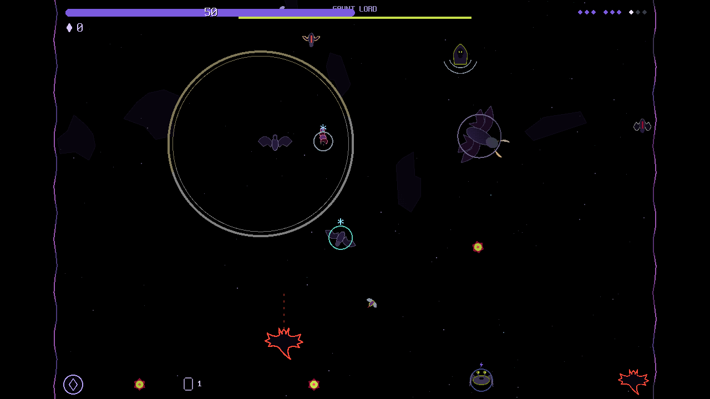
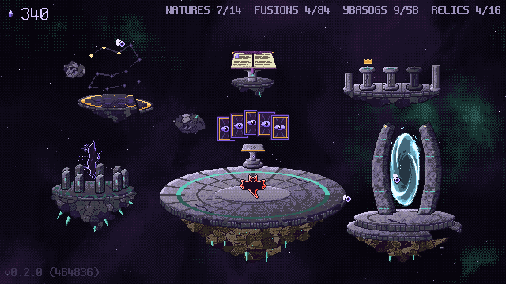

# Voidwalker

Voidwalker (also known as Virtuousins) is a top-down deckbuilding shooter. You play a blob born in the void. Every shot fires the next card in your deck, and every bolt can ricochet off a wall, an asteroid, or a Ybasog hunting you through the rift.

At the Rift Altar you choose which cards you want to find. Your first adventure starts with a single Void Bolt. Pick up cards as you fight, then decide at a Rift Rest whether to strengthen a card or fuse two natures. The seven sins and seven virtues give you 14 natures to work with. Wrath is fire, Patience is ice, and those two cancel each other out. Other pairs can produce one of 84 fusions.



## Play the browser adventure

Clone or download the repository, then open `prototypes/voidwalker/index.html` in a desktop browser. The prototype runs directly from the checkout. Press **Enter** to begin, move with **WASD** or the **arrow keys**, aim with the mouse, and hold the **left mouse button** to fire. **Q** toggles auto-fire and **Space** pauses. The game reference covers progression, enemy families, and fusion recipes. [Game reference](design/voidwalker-reference.md)

## Build and run the Godot port

The Godot build currently opens at the Rift Altar with a playable demo collection. Each station floats on its own island in deep space. The Void Rite is a crack in space-time leaking void, and the Rift Gate holds a rift painted in the chosen nature. Void balls seep out of the crack and drift through the lobby before the rift draws them in. Tap a ball and it either dodges or bursts. The blob on the altar takes the form of your pool's main nature, and equipped relics float over their pedestals. The six stations let you manage your pool, draw cards, buy sigils, equip relics, read the journal, and choose a rift. Combat and the three-stage adventure are still only playable in the browser prototype.



Install the **.NET 10 SDK** and the **Godot 4.8 beta 4 .NET editor**. Run these commands from the repository root in Bash or Git Bash. Set `GODOT` to your .NET editor executable. If it is already on your path as `godot`, the example works as written.

```bash
export GODOT=godot
dotnet build Voidwalker.sln
"$GODOT" --headless --path . --import
"$GODOT" --path .
```

## Test-play as a developer

Run the game from the repository root after `dotnet build` and the import step above. The desktop window opens at 1280x720 and shows the 640x360 game area at 2x. Hover over a station to light it up, then click it to open its screen. **Escape** or the back button closes a screen. On a touch screen, the first tap lights a station and the second tap opens it.

The game picks its pixel scale from the window size, so window sizes can stand in for devices.

| Window | Game area | Stands in for |
|---|---|---|
| `--resolution 1280x720` | 640x360 at 2x | desktop (default) |
| `--resolution 1386x640` | 693x320 at 2x | a wide phone (the test phone shows the same area at 4x) |
| `--resolution 1066x600` | 533x300 at 2x | the smallest area the layout supports |

```bash
"$GODOT" --path . --windowed --resolution 1386x640
```

Options after a bare `--` belong to the game. Use them to jump straight to what you are testing.

| Option | What it does |
|---|---|
| `--open=<station>` | Opens a station screen at start: `deck` (the Pool), `rite`, `gate`, `sigils`, `relics`, or `journal`. |
| `--tab=<tab>` | Starts the Journal on `quests`, `logs`, `codex`, `bestiary`, or `natures`. Use it with `--open=journal`. |
| `--shot=<file.png>` | Saves the game area after 30 frames, then quits. |
| `--auto-tap` | Taps a void ball every 1.2 seconds and logs each tap, to check the dodge and burst. |

```bash
"$GODOT" --path . -- --open=journal --tab=codex
"$GODOT" --path . --windowed --resolution 1386x640 -- --shot=lobby-phone.png
```

To watch motion frame by frame, record a run with Godot's movie writer. This command saves 30 seconds at 30 fps as numbered PNGs.

```bash
mkdir -p movie
"$GODOT" --path . --write-movie movie/f.png --fixed-fps 30 --quit-after 900
```

**Your save.** The collection is saved to `user://save.json`. On Windows that is `%APPDATA%\Godot\app_userdata\Voidwalker\save.json`. A first launch with no save starts the demo collection. If the save cannot be read, the game leaves the file alone and shows **SAVE PROTECTED** in the HUD, and changes in that session are not kept. Copy the file before a test that changes your collection. To start over, use **RESET TO DEMO** on the Journal's Natures tab and tap it twice, or delete the file while the game is closed.

**Tuning.** Lobby values live in `src/data/hub_config.tres`. They include how many void balls there are and how fast they drift, the tap radius and burst chance, the trails, the star blink and the asteroid drift. Each value is documented in `src/hub/HubConfig.cs`. Edit them in the Godot inspector or in the file, then run the game again.

**Version label.** The HUD shows `v0.2.0 dev` from `project.godot` unless `src/data/build_info.json` exists. The Android export script writes that file, and it is gitignored. After an Android build, the desktop build shows that APK's version until you delete the file.

**Lobby art.** The lobby sprites are drawn in code, with no image model. To change one, edit `tools/art/gen_lobby.py`, then regenerate the specs, render them, and pack them:

```bash
python tools/art/gen_lobby.py assets/art-src/lobby --scale 0.5
mkdir -p render
for f in assets/art-src/lobby/*.pixelspec.json; do
  n=$(basename "$f" .pixelspec.json)
  python .claude/skills/codeart2d/scripts/render_pixelspec.py --spec "$f" --output-dir "render/$n" --strict-qc || exit 1
done
python tools/art/pack_lobby.py render assets/art-src/lobby assets/sprites/lobby
"$GODOT" --headless --path . --import
```

The Gate rift and the void effects (the Rite crack and the ball burst) are pixelfx effects in `tools/art/fx/arcane/`. Bake them with `python tools/art/bake_gate_rift.py` and `python tools/art/bake_void_fx.py`, which need Node. The renderer (`.claude/skills/codeart2d/`) and pixelfx (`tools/pixelfx/`) are local tools that are not in the repository yet, so these steps only work where they are installed. The game runs from the committed sprites without them.

## Test the port

Run the rules and save regression tests from the repository root. The suite checks card draws against fixtures from the browser game, exercises save preservation and the reset flow, and checks the void balls' paths: their bounds, pace, waypoint hops and depth lanes.

```bash
dotnet test Voidwalker.sln
```

After building and importing, launch each station headlessly to check that its scene and resources load. Check the output for engine errors as well as the process exit status.

```bash
for station in deck rite sigils relics gate journal; do
  "$GODOT" --headless --path . --quit-after 8 -- "--open=$station" || exit 1
done
```

## Build for Android

Install the matching **Godot 4.8 beta 4 Mono export templates** and configure Godot’s Android export settings with **JDK 17** and the **Android SDK**. The tested setup used SDK 36. With `GODOT` set as above, build the signed ARM64 debug APK from Bash or Git Bash.

```bash
bash tools/build/android_export.sh
```

The APK is written to `build/android/Voidwalker-debug.apk`. To install it on a connected test device with USB debugging enabled, run `adb install -r build/android/Voidwalker-debug.apk`. The device test report records all six touch flows, including removal of the sixteenth pool stack and a confirmed reset that survived a cold restart. [Android smoke-test results and screenshots](production/qa/evidence/hub-port/android-stations/README.md)

## The Voidwalker Codex

The Codex is the game's reference as one web page: every nature, fusion, form, Ybasog and tuning value, the Rift Altar, the migration to Godot, and the history. Each section shows whether it comes from the Godot port or still from the browser build. Build it, serve it on a local server and open it with Node and Python:

```bash
bash tools/codex/serve.sh
```

The page is written to `build/codex/voidwalker-codex.html`. Its text comes from the [game reference](design/voidwalker-reference.md).

## Credits

Voidwalker uses **Claude Code Game Studios** by Donchitos as its development template. The original MIT license is included in this repository. [Claude Code Game Studios](https://github.com/Donchitos/Claude-Code-Game-Studios) · [License](LICENSE)
